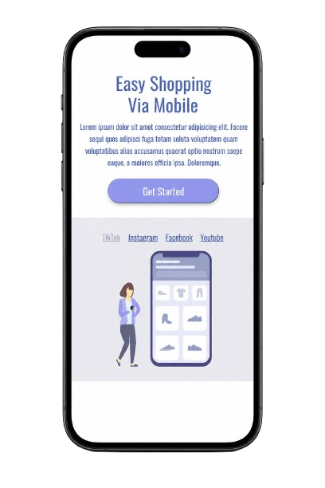

<h1>responsividade</h1>
Página web desenvolvida como parte dos meus estudos práticos em desenvolvimento front-end junto ao [DevClub](https://www.devclub.com.br/).

## 🎯 Objetivo
Aplicar e consolidar os fundamentos da criação de páginas web, estruturando o conteúdo, estilizando elementos visuais e praticando o fluxo de versionamento de código com Git e GitHub.

## 🛠️ Tecnologias Utilizadas
* **HTML5** — Estruturação semântica da página
* **CSS3** — Estilização, layout e responsividade *(remova ou ajuste conforme o que você usou no projeto)*
* **Git & GitHub** — Controle de versão e hospedagem do repositório


  
  


## 🚀 Como visualizar o projeto
1. Faça o download ou clone este repositório:
   ```bash
   git clone [https://github.com/euthiagobruno-boop/aula1.git](https://github.com/euthiagobruno-boop/aula1.git)

 
